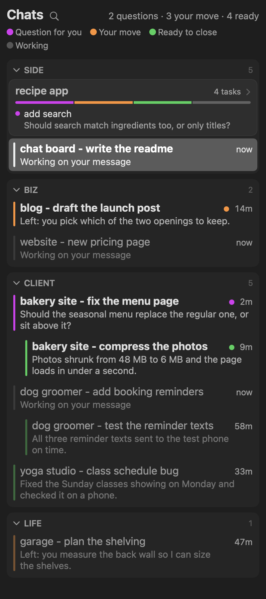
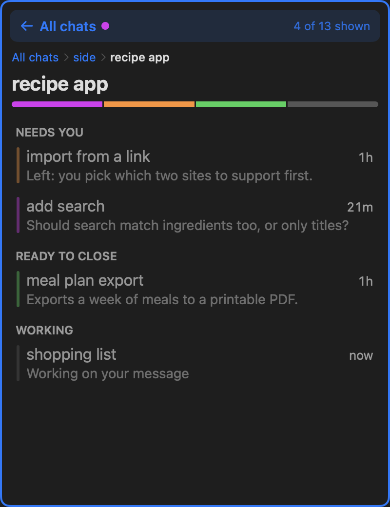

# Chat Board

I usually have 10 or more chats open in the Claude desktop app. Some are still working, some are waiting on me, and some finished a while ago. I couldn't tell which was which without clicking into each one and asking if we were done.

Chat Board fixes that. It's a window that sits to the left of the Claude app and lists every chat by what it needs from you:

- **Purple, question for you:** the chat asked you something, or it's waiting for you to OK a permission card.
- **Orange, your move:** it finished a step and something is left for you.
- **Green, ready to close:** the chat says its job is done and nothing is lost if you close it.
- **Gray, working:** it's still going.



Chats you haven't looked at since they finished are bright, and ones you've read are dimmed. Side sessions sit indented under the chat that started them. Click a chat to open it, and right-click to archive. The window and Claude always fill the screen together: drag one wider and the other shrinks to match. It only shows while Claude is in front.

## Sections and projects

The board sorts chats by their titles. I name every chat `[tag] project - task`, like `[client] bakery site - fix the menu page`, and the board reads that:

- The tag becomes a section. Click a section's header to fold it away.
- When two or more chats share a project, they become a card. The card has a bar split by status, and it shows the one task that needs you most.
- Click a card to open the project. The board shows only that project's chats, under Needs you, Ready to close and Working. A blue banner says how many chats are showing, and a blue frame goes around the board so you never mistake it for the full list. The banner, or the path under it, takes you back.
- A chat without a tag sits on its own, outside the sections.



New chats file themselves. When a chat is renamed into a project that already has a card, it joins the card. A new task in the same project keeps the chat in its spot.

You can move anything by dragging it:

- Drop a chat on the middle of a card to add it to that project.
- Drop a chat on the middle of another chat to make a new group of the two.
- Drop it on the edge of anything to put it in between. A blue line shows where it will land.
- Drag sections and cards the same way.
- On a project page, hold a dragged chat on the banner for half a second. The board goes back to all chats, and you can drop it anywhere.

Right-click has the same moves: Move to, New group with, Rename group and Ungroup. Anything you move by hand stays where you put it, and the board never files it again.

## How it works

There are two pieces, because neither can do the whole job alone.

**The mod (`hooks/`)** is a Claude Code mod that runs inside every chat. A mod can see one chat, but it can't put all of them in one list beside the app. At the end of each turn it asks the chat to report whether its purpose is done (a small `chat_status` tool call), records any question the chat asked, and notes when a tool call is held open by a card waiting for you. It writes that status to `~/.claude/chat-hud/rows/<session>.json`. It never calls a model on its own. The only cost is the small status instruction and tool each chat carries, covered under Costs.

**The app (`window/`)** is a small native Mac app in Swift. It reads those status files plus the Claude app's own chat list, and draws the board. It saves where everything sits in `~/.claude/chat-hud/layout.json`, so your order survives a restart. It uses the macOS Accessibility API to dock itself beside Claude and keep the two windows filling the screen.

The status rules live in both pieces and must agree, so both test suites read the same cases from `fixtures/describe-cases.ts`.

## Install

You need macOS 14 or later, the Claude desktop app, and Swift (Xcode or the Command Line Tools).

**1. The mod.** At the prompt of a Claude Code terminal session:

```
/plugin install chat-hud --marketplace mechanicMo/chat-board
```

Answer `y` to add the marketplace, then pick a scope (user scope makes it run in every chat). From a shell instead:

```bash
claude plugin marketplace add mechanicMo/chat-board
claude plugin install chat-hud@mo-mods
```

Chats that are already open pick it up after `/reload-plugins`.

**2. The app.**

```bash
git clone https://github.com/mechanicMo/chat-board.git
cd chat-board/window
./build.sh
open ~/Applications/Chat\ Board.app
```

The first launch asks for Accessibility permission (System Settings, Privacy & Security, Accessibility). It needs it for two things: placing itself beside Claude and resizing the two windows together, and the Cmd+D and Cmd+F shortcuts below. macOS may also ask for Input Monitoring for the shortcut.

**Cmd+D for dictation.** Claude's own Cmd+D dictation is hold-to-talk. While Claude or the board is in front, Chat Board catches Cmd+D and clicks Claude's microphone button instead, so one press starts dictation and the next stops it. Every other key passes through untouched, and Cmd+D passes through too if the button can't be found (for example while Claude shows Stop mid-reply). If an app update moves the button, `ChatBoard --find-buttons` lists the buttons in Claude's window.

**Cmd+F to search the board.** While Claude or the board is in front, Cmd+F opens a search box at the top of the board instead of Claude's find. Type to filter chats by title and status line (every word has to match, and a word can be the start of a longer one). Up and down pick a chat, Return opens it, and Escape closes the search and hands the keyboard back to Claude. To search inside the chat you're in, press Cmd+F a second time: the board's search closes and Claude's own Find opens. The magnifier next to "Chats" opens the search with the mouse. If the board is hidden, Cmd+F goes to Claude as usual.

macOS ties that permission to the app's signature. An ad-hoc signature changes on every build, so you'd have to grant it again after each rebuild. To avoid that, sign with a certificate of your own: put `SIGN_IDENTITY="<your certificate name>"` (and optionally `BUNDLE_ID=...`) in `~/.claude/chat-hud/build.env`, which `build.sh` reads. The certificate has to be trusted for code signing.

**3. Optional: private folders.** Chats started in these folders are never listed or summarized:

```json
// ~/.claude/chat-hud/config.json
{ "privateFolders": ["~/journal"] }
```

If the file is there but can't be read, both pieces hide every chat until it's fixed, rather than guess. The board re-reads the file every few seconds; open chats see a change after `/reload-plugins`.

## Archiving from the board

The Claude app's archive tool can only be called from inside a chat, so archiving goes through a request file. When you pick Archive, the app writes `~/.claude/chat-hud/requests/archive-<chat>.json` with a fresh one-time code. Any open chat with the mod picks it up within 5 seconds and calls the archive tool, quoting the code. The app shows the answer, then deletes the request.

The mod also guards the archive tool in every chat: an archive is refused unless it names a chat with a waiting request, quotes that request's exact code, and the request is under 60 seconds old. So the model in some chat can't archive your chats on its own.

To let the archive run without a permission prompt in each chat, add this to the `permissions.allow` list in `~/.claude/settings.json`:

```json
"mcp__ccd_session_mgmt__archive_session"
```

Only do this with the mod installed at user scope, because the guard only exists where the mod is loaded. Without the allow rule, archiving still works but asks for permission first.

## Costs

Nothing on the board calls a model. Each chat does carry a little extra: a status instruction of about 200 tokens and the `chat_status` tool's description in its prompt, plus one short `chat_status` call at the end of each turn. With prompt caching that is a small, steady cost per chat. The band inside each chat has a **Summarize now** button that asks Claude Haiku for a one-paragraph summary. That's the only paid feature, and it only runs when you press it or type `/hud now`.

## Commands

Inside any chat: `/hud` shows the status band, `/hud now` summarizes, and `/hud off` / `/hud on` takes that chat off the board or puts it back.

## Tests

```bash
claude plugin test .                 # the mod: status rules, waiting cards, privacy, archive guard
window/scripts/test.sh               # the app: status rules, ordering, unread, filters, docking math
window/scripts/snapshot-check.sh     # renders the board and a project page from demo data and checks all four colors are drawn
```

`test.sh` runs `swift test`, adding the flags Swift Testing needs when only the Command Line Tools are installed. For troubleshooting, the app writes what it sees about the screen and its permissions to `~/.claude/chat-hud/dock-status.json`.

### End-to-end tests

The parts unit tests can't reach (docking and resizing, where the keyboard goes after a click, Cmd+F, Cmd+D, opening cards and folding sections, dragging between sections and cards, the right-click menus, the menu bar toggle) have end-to-end tests that press real keys and click the real mouse:

```bash
window/scripts/e2e.sh                              # all 31 tests
E2E_ONLY=search,focus window/scripts/e2e.sh        # some groups: docking focus search dictation order groups archive config
```

They run the board on the demo chats beside **Stand-in Claude** (`window/Sources/StandIn`), a small app with a message box, a microphone button and an Edit > Find menu that logs every key and press it receives. The board is pointed at it with `CHAT_BOARD_TARGET`, so the tests never touch real chats, and they don't need the Claude app installed. The runner (`window/Sources/E2E`) reads where keystrokes landed from the stand-in's log and what the board shows from a state file the board writes only when `CHAT_BOARD_STATE` is set.

The run takes over the keyboard and mouse for about two minutes, so it belongs on a Mac nobody is using. Set `E2E_HOST` (and optionally `E2E_SSH_KEY`, `E2E_REMOTE_DIR`) in `~/.claude/chat-hud/e2e.env` to run it on another Mac over ssh; without it, it runs on this one after a countdown. That Mac needs to be logged in with its screen unlocked, and the first run there needs Accessibility switched on for **Chat Board E2E** and **Chat Board Test**. Sign with a fixed certificate (`SIGN_IDENTITY`, as for `build.sh`) so those grants survive rebuilds. Before every key or click the runner checks that the stand-in or the board is in front, and stops the run if anything else is.

Two things stay manual: real hardware focus quirks of the actual Claude app, and full-screen mode (the board stays out of a full-screen Claude). To check that the real Claude app still has the two controls the shortcuts press, with Claude idle and a chat's message box showing:

```bash
~/Applications/Chat\ Board.app/Contents/MacOS/ChatBoard --check-claude   # read-only; presses nothing
```

To render the board without any real chats, use demo data:

```bash
python3 window/demo/make-demo.py /tmp/chat-board-demo
CHAT_BOARD_DEMO=/tmp/chat-board-demo ~/Applications/Chat\ Board.app/Contents/MacOS/ChatBoard --snapshot board.png --width 460 --height 640
```

## Caveats

This reads the Claude desktop app's local chat records and uses its `claude://` chat links. Neither is a documented API, so an app update can break the board until it's adjusted. It's a personal tool that I use every day, shared as is.

## License

MIT
